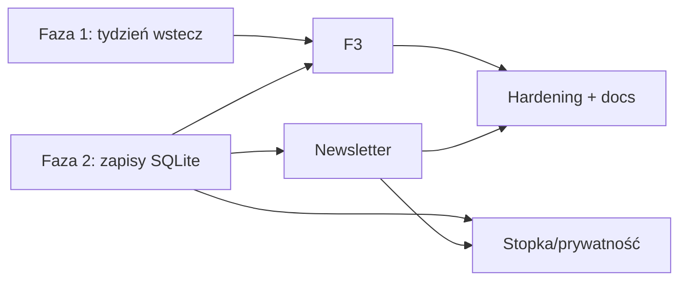

# Plan rozwoju lecture_chooser

## Stan projektu (V3 — ukończone)

- Kalendarz tygodniowy z rozkładu zajęć + plan studiów, ograniczenia wyboru (`settings.json`).
- Wybór zajęć zapisywany w **podpisanym ciasteczku** (`app/logic/selection.py`) — brak stanu po stronie serwera.
- Tryby kalendarza: „Tydzień ogólny" (cykle A/B/1–4) i „Tydzień obecny" (rzeczywiste daty z terminarzy); nawigacja wstecz zablokowana na bieżącym tygodniu (`renderWeekSwitch`, `minW = cw`).
- Scraping e-KUL: kolejka, scheduler, storage plikowy w `app/data/scraped/` (nadpisywany in place — brak historii wersji).
- Stack: Quart + hypercorn, vanilla JS/CSS, testy pytest w `tests/`.

---

# V4 — Obecność, zapis po stronie serwera, newsletter

## Wymagania (od użytkownika)

1. Oznaczanie obecności na zajęciach w planie; % obecności w semestrze na kartach przedmiotów.
2. Newsletter o zmianach na kierunku — opt-in, opt-out, wysyłka przez Stalwart (SMTP).
3. Nawigacja tygodniowa **w obie strony** (cofanie do tygodnia 1, nie tylko do bieżącego).
4. Zapis po stronie serwera w stylu codeshare: dowolny ciąg po slashu można „zająć" jako swój; opcjonalne hasło (bez hasła = publiczny, każdy może edytować); śledzenie ostatniego otwarcia; usuwanie po 4 miesiącach bez otwarcia (retention jako env var w compose).
5. Ochrona przed DDoS i masowym tworzeniem zapisów (zapychanie dysku); wydajna forma zapisu.
6. Stopka: info o retention, przetwarzaniu danych i szyfrowaniu — małe linki + wyskakujące okienko.
7. Solidne hashowanie haseł (argon2id).

## Architektura V4 — decyzje

- **Storage zapisów: SQLite** (`app/data/saves/saves.db`, WAL) — pojedynczy plik, atomowe zapisy, indeksy, wydajne przy wielu rekordach; zamiast tysięcy plików. Katalog `app/data/saves/` bind-mountowany w compose **wzorcem istniejącego `./app/data/scraped`** (katalog, nie pojedynczy plik — SQLite WAL tworzy pliki poboczne `-wal`/`-shm` obok bazy, więc bind na sam plik `.db` by się wysypał).
- **Hasła: argon2id** przez `argon2-cffi` (wymagania: memory ≥ 64 MB, iterations ≥ 3, parallelism 1–4).
- **Rate limiting: własny, w pamięci** — token bucket per IP na endpointach zapisu/newslettera (Quart nie ma wbudowanego; unikamy zależności od zewnętrznego limitera). **Caddy już stoi przed aplikacją** (osobny kontener, poza tym repo — aplikacja nie ma i nie będzie miała dostępu do jego konfiguracji), więc warstwa L7/DDoS jest po stronie Caddy; limity w aplikacji chronią logikę biznesową (masowe claimy, wysyłka maili), a nie sam ruch HTTP.
- **Newsletter: SMTP przez `aiosmtplib`** (Stalwart = standardowy submission: STARTTLS/587 lub SSL/465). Opt-out = podpisany URL-token (itsdangerous) w stopce każdej wiadomości — klik działa bez logowania.
- **Detekcja zmian na kierunku:** po każdym refreshu scrapingu liczymy hash treści per (kid, etap) i zapisujemy w tabeli historii; zmiana hasha → kolejkujemy digest do subskrybentów tego kid.
- **Obecność:** przechowywana w rekordzie zapisu (per slug), klucz = `(zid, identyfikator spotkania: data lub tydzień+cykl)`, wartość = `present | absent | none`.

---

## Faza 1 — Nawigacja tygodni wstecz (mały frontend)

- [x] `app/static/app.js` `renderWeekSwitch()`: `minW = 1` zamiast `minW = cw` (tryb „Tydzień obecny"); przycisk ◀ aktywny aż do tygodnia 1.
- [x] Zaktualizować komentarz/komunikaty (obecnie „wstecz tylko do bieżącego tygodnia").
- [x] Test ręczny: cofanie do tygodnia 1, granice disabled, brak regresji w trybie ogólnym.

**Kryteria:** w trybie „obecny" można przejść do każdego tygodnia 1..semesterWeeks w obie strony.

## Faza 2 — Zapis po stronie serwera (codeshare) — fundament V4

Nowy moduł `app/saves/` (`store.py`, `routes.py`, `ratelimit.py`) + tabela SQLite.

- [x] **Model danych** (`saves`): `slug` (PK), `payload` (JSON: selected, week, kid, etap, attendance), `pw_hash` (NULL = publiczny), `created_at`, `updated_at`, `last_opened`, `owner_ip_hash` (hash IP do limitów, nie do identyfikacji).
- [x] **Slug:** ciąg podany przez użytkownika po `/s/<slug>`; walidacja: 3–64 znaki, `[a-z0-9._~-]`, lista zarezerwowanych (`api`, `static`, `newsletter`, …). Claim: `POST /api/saves/<slug>` — wolny slug → zajęcie; istniejący z hasłem → 401/403 bez poprawnego hasła; istniejący bez hasła → nadpisanie przez każdego (zgodnie z wymogiem „publiczny").
- [x] **Odczyt:** `GET /s/<slug>` — strona z planem (render jak `/`, dane z payloadu); `GET /api/saves/<slug>` — JSON; każde otwarcie aktualizuje `last_opened` (throttle: max 1 update/min na slug, żeby nie pisać przy każdym odświeżeniu). Otwarcie cudzego sluga **nie nadpisuje własnego wyboru z ciasteczka** — jak obecnie przy linkach `?z=` (tryb podglądu + toast).
- [x] **Zarządzanie hasłem sluga:** `PUT /api/saves/<slug>/password` — ustawienie nowego hasła, zmiana (wymaga podania obecnego, jeśli ustawione) oraz **wyczyszczenie do pustego** (slug wraca do publicznego — bez tworzenia nowego sluga). Usunięcie/zmiana hasła wymaga hasła obecnego (ochrona przed przejęciem cudzego sluga).
- [x] **Retention:** `RETENTION_DAYS` (env, domyślnie 120 = 4 miesiące); zadanie w tle (asyncio, start z aplikacją przez pełny lifespan, cykl od razu potem co 6 h) usuwa zapisy z `last_opened` starszym niż retention; logowanie liczby usuniętych.
- [x] **Rate limiting / anti-abuse:**
  - token bucket per IP: np. 10 claimów/h, 60 zapisów/min, 120 odczytów/min;
  - limit rozmiaru payloadu (np. 64 KB) i liczby zajęć w wyborze;
  - globalny cap liczby zapisów (`MAX_SAVES`, env, np. 20 000) + per-IP cap (np. 20);
  - odpowiedź 429 z `Retry-After`; limity konfigurowalne env vars;
  - limit prób hasła per slug+IP (np. 10/h) — ochrona przed brute force na chronionych slugach (argon2id spowalnia, ale limit i tak potrzebny);
  - uwaga: aplikacja jest za Caddy (osobny kontener) — odczyt IP klienta przez `X-Forwarded-For` (zaufany tylko od Caddy; env `TRUSTED_PROXY`/`PROXY_HEADER` do włączenia), inaczej limity per-IP trafią na IP proxy i zablokują wszystkich.
- [x] **Integracja z UI — slug zastępuje naiwne „Udostępnij” (`sharePlan`/`shareURL` w `app.js`):**
  - **„Udostępnij"** (przycisk zostaje, zmienia się działanie): tworzy slug — jeśli plan ma już swój slug (pamiętany w localStorage), używa go; w przeciwnym razie generuje losowy slug, claimuje go i udostępnia link `/s/<slug>` (telefon: systemowe okno udostępniania, PC: schowek — oba istniejące mechanizmy zostają). Stare linki `?z=` nadal działają (odczyt bez zapisu).
  - **„Zapisz"** (nowy przycisk): modal z pytaniem o **własny string sluga** (użytkownik nie zgadnie sam, że ma dopisać `/s/xyz` do URL) + opcjonalne hasło; zapisuje bieżący plan (wybór + obecność) pod slugiem; konflikt zajętego sluga z hasłem → komunikat i prośba o hasło/inny slug.
  - **Status otwartego sluga — wyraźne oznaczenie, bez wątpliwości:** gdy użytkownik jest na `/s/<slug>`, pasek/baner pokazuje stan: „Slug publiczny — każdy może edytować" albo „Slug chroniony hasłem" (+ czy użytkownik ma do niego dostęp do zapisu). Na slugu publicznym opcja **„Ustaw hasło"**; na chronionym — „Zmień hasło" i „Usuń hasło" (oba po podaniu obecnego hasła).
  - Zapisany slug pamiętany w localStorage i URL (`?s=slug` / `/s/slug`).
- [x] **Ciasteczkowanie zostaje bez zmian:** domyślny tryb dla osób preferujących „po staremu" — zapis wyboru w podpisanym ciasteczku działa równolegle ze slugami; slug to opt-in przez „Udostępnij"/„Zapisz". Otwarcie `/s/<slug>` nie rusza ciasteczka użytkownika.
- [x] **Compose/env:** bind mount `./app/data/saves:/lecture-chooser/app/data/saves` (wzorzec `./app/data/scraped` — trwałość między restartami; katalog z powodu plików WAL), `RETENTION_DAYS`, `MAX_SAVES`, `MAX_SAVES_PER_IP`, `TRUSTED_PROXY` (sieci CIDR zaufanych proxy).
- [x] **Testy:** `tests/test_saves_store.py`, `tests/test_saves_api.py` (claim, kolizje, hasło: ustawienie/zmiana/usunięcie, próby bez hasła), `tests/test_ratelimit.py`, `tests/test_retention.py` — wszystkie przechodzą.

**Kryteria:** zapis/odczyt/claim działa; publiczny slug edytowalny przez każdego, z hasłem tylko po podaniu hasła; status sluga (publiczny/chroniony) zawsze widoczny na `/s/<slug>`; hasło da się ustawić, zmienić i wyczyścić bez tworzenia nowego sluga; „Udostępnij" tworzy link `/s/<slug>`; stare linki `?z=` i tryb ciasteczkowy działają bez regresji; stare zapisy usuwane; masowe tworzenie z jednego IP blokowane limitem.

## Faza 3 — Obecność i % w semestrze (zależy od Fazy 1 i 2) — UKOŃCZONA

(weryfikacja ręczna UI odroczona do testów live po zakończeniu całości V4 — decyzja użytkownika)

- [x] **Model:** w payloadzie zapisu mapa `attendance`: `"<zid>:<meeting_key>" -> "present"|"absent"`; `meeting_key` = data ISO dla spotkań datowanych, inaczej `w<tydzień>` (spójne z `weekOfDate`/cyklami).
- [x] **UI — kalendarz (tryb „obecny"):** tap/klik na kafelku zajęć → toggle obecność (obecny/nieobecny/brak); wizualne oznaczenie (✓/✗/kropka); działa też na cofniętych tygodniach (stąd Faza 1).
- [x] **UI — karty przedmiotów (picker):** % obecności w semestrze = obecne spotkania / wszystkie spotkania przedmiotu do dziś (lub w całym semestrze — **decyzja poniżej**); pasek/kolor progu.
- [x] **UI — obecność ogólna na semestr:** zbiorczy % (wszystkie zaznaczone przedmioty łącznie, ten sam mianownik co per-przedmiot) pokazany w **pasku statusu w topbarze** (obok licznika godzin/limitów — zawsze widoczny, także na mobile dzięki sticky); w trybie „obecny" aktualizuje się na żywo przy oznaczaniu.
- [x] **Zapis:** zmiany obecności zapisywane do zapisu serwerowego (autosave debounced) i/lub localStorage dla niezapisanych planów.
- [x] **Testy:** `tests/test_attendance.py` (klucze spotkań, wyliczanie %, przypadki brzegowe: zajęcia odwołane przez events.json nie liczą się do mianownika).

**Kryteria:** spełnione (weryfikacja ręczna po całości V4). Mianownik % — **rozstrzygnięte:** do dziś (domyślnie) + przełącznik „cały semestr” w UI.

## Faza 4 — Newsletter zmian na kierunku (zależy od Fazy 2 — infrastruktura DB) — UKOŃCZONA

(testy uruchamiane zbiorczo po zakończeniu całości V4 — decyzja użytkownika)

- [x] **Subskrypcje (opt-in podwójny) — dwa zakresy:** tabela `subscribers` (`email`, `scope` course|slug, `kid`/`slug`, `confirmed`, `created_at`, `last_sent`) w tym samym SQLite co zapisy; deduplikacja (adres+zakres), capy `MAX_SUBSCRIBERS`/`MAX_SUBS_PER_EMAIL`:
  - **z poziomu nie-slugu (tryb ciasteczkowy):** przycisk „Obserwuj” → modal z adresem e-mail — subskrypcja **całego kierunku**;
  - **z poziomu sluga (`/s/<slug>`):** ten sam przycisk — subskrypcja **tylko przedmiotów wybranych na slugu**, powiązana ze **slugiem**: kid i zakres rozwiązywane z payloadu sluga NA ŻYWO przy wysyłce (zmiana wyboru bez ponownej rejestracji; slug bez wybranych przedmiotów → brak digestu);
  - mail potwierdzający z linkiem `/newsletter/confirm?token=…` (itsdangerous, sekret SECRET_KEY); dopiero po kliknięciu `confirmed=1`;
  - **Retencja a subskrypcje slugowe:** usunięcie sluga przez retention → **ostatni mail o wygaśnięciu**, potem usunięcie subskrypcji (`delete_expired(deleted_slugs=…)` → `notify_slug_expired`).
- [x] **Opt-out:** podpisany link `/newsletter/out?token=…` w stopce **każdej** wiadomości; klik = natychmiastowe usunięcie + strona potwierdzenia. Dodatkowo `/newsletter/manage?token=…` — lista subskrypcji adresu z linkami rezygnacji.
- [x] **Detekcja zmian:** hook w `on_refreshed` (queue) → hash treści katalogu kierunku (`plan.html`/`week.html`/`sales/*.html` — pliki stanu z znacznikami czasu wykluczone) per kid → tabela `course_versions`; zmiana → `change_events` (kid, czas, summary). Minimalny summary („dane kierunku zaktualizowane”) zgodnie z opcją „minimalnie” z planu — pełny diff wymagałby snapshotu metadanych (odroczone, patrz Ryzyka).
- [x] **Wysyłka:** cykl dzienny (co 5 min sprawdzenie, env `NEWSLETTER_DIGEST_HOUR`, domyślnie 18; idempotentny po dacie w `newsletter_meta`) — digest per adres (grupowanie subskrypcji, wiele kierunków = jeden mail); SMTP przez `aiosmtplib` z env `SMTP_HOST`/`SMTP_PORT`/`SMTP_USER`/`SMTP_PASSWORD`/`SMTP_FROM`/`SMTP_TLS` (`starttls|ssl|none`) + `BASE_URL` (absolutne linki). Nieudana wysyłka nie oznacza subskrypcji jako obsłużonej (retry następnego cyklu).
- [x] **Anti-abuse:** rate limit (token bucket): zapis subskrypcji 5/h per IP, maile potwierdzające 5/dobę per adres, linki 30/h; capy subskrypcji (507 przy przekroczeniu).
- [x] **Compose/env:** sekcja SMTP w `docker-compose.yml` (zakomentowany wzorzec jak EKUL_*); bez `SMTP_HOST` usługa newslettera nie startuje (aplikacja działa normalnie).
- [x] **Testy:** `tests/test_newsletter.py` (store: deduplikacja/capy/confirm; detekcja zmian z wykluczeniem plików stanu; digest: course scope, slug scope na żywo z payloadu, grupowanie, retry po błędzie SMTP; wygaszanie slugów; tokeny; trasy: subscribe→confirm→out, manage, walidacja, 503 bez SMTP, rate limit 429), `tests/test_smtp_client.py` (mock aiosmtplib: pola wiadomości, starttls/ssl/none).

**Kryteria:** opt-in wymaga potwierdzenia mailem; każda wiadomość ma działający opt-out; zmiana danych kierunku po refreshu skutkuje digestem; subskrypcja z nie-slugu = cały kierunek, subskrypcja ze sluga = zawsze aktualnie wybrane przedmioty sluga (bez re-rejestracji po zmianie wyboru); brak SMTP = funkcja wyłączona, aplikacja działa.

## Faza 5 — Stopka / prywatność (zależy od Fazy 2 i 4 — finalne parametry) — UKOŃCZONA

- [x] W `templates/index.jinja2` mały link „Prywatność i dane” w stopce → modal (wzorzec istniejących pop-upów, mobile-friendly).
- [x] Treść modala: retention zapisów (`RETENTION_DAYS` przez kontekst szablonu + `default(120)`), co przechowujemy (plan, obecność, email — tylko po opt-in), hasła argon2id (nigdy nieodwracalne), HTTPS, kontakt/usuwanie danych.
- [x] W stopce newslettera: opt-out + krótkie info o przetwarzaniu (digest: opt-out per subskrypcja przy wielu obserwacjach).
- [x] Test: `tests/test_privacy_footer.py` (link i modal obecne, treść zawiera retention z env, stopka newslettera).

## Faza 6 — Hardening i dokumentacja — UKOŃCZONA

- [x] Przegląd bezpieczeństwa: argon2id parametry; **timing equalizer usunięty** (stan „czy slug ma hasło” jest i tak jawny w API — baner statusu; nie ma sekretu do ochrony); brak wycieku IP w logach (hash sha256+sekret); ciasteczka `HttpOnly`+`SameSite=Lax` — flaga `Secure` udokumentowana w README (wymaga `X-Forwarded-Proto` po stronie Caddy).
- [x] README: nowe env vars (retention, SMTP, limity, `TRUSTED_PROXY`), sekcje „Zapisy planów na serwerze (v4)”/„Obecność (v4)”/„Newsletter (v4)”/„Prywatność”; notka o Caddy (limity proxy poza tym repo).
- [x] `requirements.txt`: `argon2-cffi`, `aiosmtplib`.
- [ ] Przegląd wydajności zapisów: benchmark claim/save pod limitem (cel: <10 ms na zapis przy 20k rekordów) — **odroczony do testów live** (wymaga runtime).

---

## Zależności

## Ryzyka

- **Spory payload zapisu przy dużej obecności** — mapa attendance rośnie; limit 64 KB + ewaluacja kompresji (zlib w payloadzie) jeśli potrzebna.
- **Detekcja zmian bez historii wersji** — scraping nadpisuje pliki in place; hash po refreshu wykryje zmianę, ale nie da pełnego diffu (co się zmieniło) bez przechowywania poprzedniej wersji. Minimalnie: „zmieniło się", docelowo: snapshot metadanych zajęć w `course_versions`.
- **Publiczne slugi bez hasła = vandalizm/walka o nazwy** — zgodnie z wymogiem użytkownika; łagodzone przez `updated_at`, możliwość hasła i jego zmiany/usunięcia bez nowego sluga.
- **Brute force haseł slugów** — argon2id + limit prób per slug+IP; publiczny slug można „przejąć" tylko przez ustawienie hasła, więc ustawienie hasła na slugu publicznym powinno być możliwe tylko dla… każdego (zgodnie z wymogiem) — ryzyko akceptowane, bo slug publiczny z definicji należy do nikogo.
- **Stalwart jako open relay dla potwierdzeń** — limity wysyłki per email/IP; bounces → automatyczne usunięcie subskrypcji po N twardych odbiciach.

## Otwarte decyzje (do potwierdzenia przed implementacją)

1. Mianownik % obecności: do dziś vs cały semestr (plan: do dziś + przełącznik).
2. Prefiks ścieżki zapisów: `/s/<slug>` (plan) — czy inny?
3. Czy obecność ma być dostępna także bez zapisu na serwerze (tylko localStorage)? (plan: tak, localStorage jako fallback).
4. Częstotliwość digestu newslettera: co godzinę vs raz dziennie (plan: raz dziennie, env).
5. ~~Subskrypcja slugowa po usunięciu sluga przez retention~~ — **rozstrzygnięte:** ostatni mail z informacją o wygaśnięciu, potem usunięcie subskrypcji.

## Następne zadanie

**V4 zakodowana w całości** (Fazy 1–6; testy pytest zielone). Pozostaje:
1. Testy live po deployu (checklist w rozmowie): slugi/hasła, obecność, newsletter ze Stalwartem, cofanie tygodni, modal prywatności, topbar na mobile.
2. Benchmark zapisów (Faza 6, odroczony).
3. Deploy checklist: `TRUSTED_PROXY` = CIDR sieci Caddy, `BASE_URL` przy włączonym SMTP, `pip install -r requirements.txt` (argon2-cffi, aiosmtplib).
